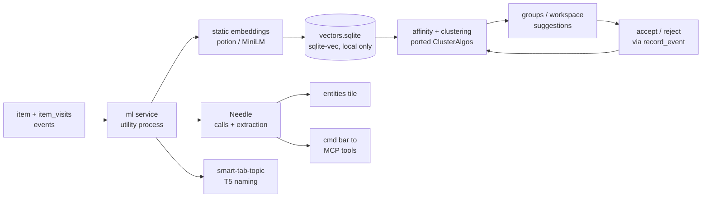
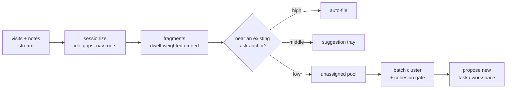

# Local AI for Peek: Needle + Firefox approaches

Research dated 2026-09-20. Source file: `Peek-Needle-Firefox-for-entities-and-workspaces.md` (repo root, untracked at filing time). Full text is below so this item stands alone.

## Related items

- `item_1789269464776_44bb0l38l` — "use simple clustering for ongoing indexing … automated workspaces; if that doesn't work, look at how firefox does tab group suggestions". This research is the Firefox half of that note, and proposes the clustering design.
- `item_1787301423604_e9ozgrpjk` — editor micro-model features "(with needle?)". Same model, a different consumer of the proposed `ml` service.
- `item_1788265099304_2ay9kl3x8` — sensor synthesis / event processors for model training. Overlaps the accept/reject-events-as-training-data loop.
- `b15ed9f1-d668-434d-9969-a447738adf38` — entity detection audit (false positives, run-on extraction). Its page catalog is the natural labelled set for the entities bake-off row.
- `27e14b65-bcf4-41ab-9d0e-9c017d0c9405` — entity widget appears fully broken (needs review). The existing extractors have to work before a fourth is added to the merge.
- `27cbb497-427c-4a30-a1f9-084e33f436b3`, `90a34a13-0a48-488e-9f6a-8f08fa613572` — entities in cmd search; clickable entities in the page-host widget. Downstream consumers of better extraction.
- `e6d3c4a7-7552-484a-93ff-2d2160e22f18` — slidebar workspace card-grid for spaces. A display surface for detected workspaces.

## First steps (nothing here is decided until measured)

1. 30-minute Needle smoke test on a real machine: `pip install cactus-needle`, run `extract()` with an entities schema and `complete()` with the 13 MCP tool schemas. The research environment could not download the weights, so Needle is untested.
2. Check the `wasm` platform folder for the undocumented JS API before committing to Needle in Electron.
3. Label one week of `item_visits` + notes into tasks (~300 items, 15–30 tasks), then run the bake-off table below.

---

Use Needle as Peek's action and extraction layer, not as its clustering engine. Clustering and workspace suggestion should copy Firefox's embed-then-cluster pipeline, fed with Peek's richer visit signals.

## Recommended stack

No single small model covers every job. The best setup combines three layers: cheap embeddings for everything, a clustering algorithm that uses Peek's visit graph, and Needle for turning text into typed calls and fields.

| Peek job | Primary component | Needle's role | Fallback / baseline |
| --- | --- | --- | --- |
| Always-on indexing of items (URLs, notes) | Static embeddings (Model2Vec `potion-retrieval-32M`, as Firefox semantic history now uses) | Candidate: Needle `embed()`. It needs benchmarking first (3072 dims, no public scores) | Frecency + tokenized search (current) |
| Task / workspace clustering from activity | Weighted affinity (semantic + navigation chain + time + tags), then agglomerative clustering with a cohesion filter (Firefox's algorithm) | None in the clustering itself | Tag-based groups (current) |
| "What else belongs in this workspace?" | Nearest neighbour to the anchor items, then a small logistic-regression fusion trained on accept/reject events | Optional yes/no classifier per candidate via `extract()` with a `Literal` field | Same-domain + same-session heuristics |
| Naming a cluster | c-TF-IDF keywords, then `Mozilla/smart-tab-topic` (57 MB T5, MPL-2.0) | Pick a label from the keyword candidates with an enum field (always a valid, extractive label) | Top keyword |
| Entity detection in pages and notes | Current regex + microformats + JSON-LD, plus an ML pass | `extract()` with typed array fields (people, orgs, places, events with date/venue). Output is span-grounded, so it does not invent entities | GLiNER (zero-shot NER, ONNX) for long text |
| Natural language to Peek API (cmd bar, tag actions, scripts) | Needle `complete()` over the MCP tool schemas | **Primary.** This is what Needle is built for | Existing cmd parser |

Peek's own TODO says the app should learn the user "w/o AI as requirement". Every row above therefore keeps a non-ML baseline, and the models only rerank or suggest on top of it.

## Needle 3: what it is

Needle 3 is a 29–121M-parameter model built only for tool calls, structured extraction and embeddings. It gives up chat ability to do those well. It ships as a single 8–29 MB 2-bit binary, and you can choose any depth from 2 to 20 layers.

| Attribute | Value |
| --- | --- |
| Outputs | JSON tool calls, typed extractions, unit-norm embeddings |
| Size | 8–29 MB weights, engine under 1 MB |
| Context | 8,192 tokens; 1,024-token local window, with full attention at layers 4, 9, 14 and 19 |
| Embedding | 3,072 floats (4 probe queries × width 768). No MTEB or other public retrieval scores |
| Tools per turn | 5 or fewer are rendered directly. Above that, embedding retrieval keeps only the top 5, and the rest are unreachable that turn |
| Arrays | At most 64 items per array argument |
| String arguments | Copied verbatim from spans in the request. A required field with no evidence is withheld rather than guessed |
| Confidence | A calibrated `confidence` score on every turn. Calls below 0.1 go to `suppressed_calls` |
| Targets | macOS, Linux, Windows, iOS, Android, and WASM (browser and Node) as `needle.js` + `needle.wasm` |
| Fine-tuning | LoRA through the Python CLI (`needle finetune`, `needle build`). The vendor says a tuned 4-layer model passes DeepSeek V4 Flash on DroidCall |
| License | Apache-2.0 (code and weights, per the GitHub repo and HF card) |
| Speed (Raspberry Pi 5) | 400–4,000 tok/s decode, 1–10k tok/s prefill, depending on depth |
| Languages | Not documented; all examples are English |

The hard limits for Peek are these: at most 5 tools per turn, at most 64 array items, and an extractive-only output (it cannot write an abstract label like "Lisbon trip planning" unless those words appear in the input). The JS/WASM API surface is not documented; only Python and the C header (`needle_embed(text, out, capacity)`) are.

## Needle fit for each Peek job

Needle is strong where Peek needs text turned into a call or a record. It is weak where Peek needs judgement across many items at once.

| Job | Fit | Why |
| --- | --- | --- |
| Command bar / tag actions to Peek API | Strong | Peek's MCP surface has 13 narrow tools (`list_items`, `search_items`, `tag_item`, `record_event`, `list_tasks`, `complete_task`, …), which is the shape Needle is designed for. Because of the 5-tool cap, route in two steps: first pick a noun (items / tags / tasks / groups), then pass that noun's ≤5 tools. |
| Entity extraction from notes and short text | Strong | Typed arrays (people, orgs, places, events with date and venue) are span-grounded, so there are no invented entities. This covers the TODO's "ML NER" and the "meaningful numbers and their label" item. |
| Entity extraction from full web pages | Medium | The 8k context and 1k local window mean long pages must be chunked. GLiNER or a token classifier is cheaper per token for plain NER. |
| Classification (item intent, "is X part of task Y?") | Medium–strong | A `Literal` field makes it a closed-set classifier, and the confidence score supports gating. It costs one model call per candidate pair, so use it only to rerank a short list. |
| Embeddings for search and clustering | Unknown | 3,072 dims is 12 KB per item at float32 (1.2 GB per 100k items). It needs int8 or binary quantization in sqlite-vec, and there is no evidence yet that it beats MiniLM or potion on retrieval. Benchmark before adopting. |
| Clustering activity into tasks | Weak | This is a many-item similarity problem, not a single-turn call. Item IDs would have to be pasted into the prompt, and the output is capped at 64 array items. |
| Naming clusters | Weak–medium | It is extractive only. It works as "choose the best of these keyword candidates" but cannot abstract. |

Needle's biggest advantage for Peek is portability. One Apache-2.0 model with native builds for macOS, Windows, Linux, iOS and Android plus WASM covers the Electron, Tauri, Tauri-mobile and extension backends. The Transformers.js/ONNX stack is heavier on mobile.

## Needle for web-page entity extraction

Add Needle as a fourth extractor on top of the current three; do not replace them. Today the entities tile runs regex, microformats and JSON-LD in parallel and merges them in `processEntities()` with a 0.7 confidence floor. Needle would feed into that same merge.

**What each layer contributes**

| Layer | Strength | Blind spot |
| --- | --- | --- |
| JSON-LD / microformats | Exact and free; the page declares these itself | Many pages have none, or only an Article/Organization stub |
| Regex | Emails, phones, URLs, dates, money | People, organizations and places in plain prose |
| Needle `extract()` | Typed records from prose, such as an event with date and venue, or a number with its label. Output is copied from text spans, so nothing is invented | Recall on plain NER has not been measured; English only as far as documented; long pages need chunking |

**How a page moves through it**

1. **Clean text:** Reader-mode extraction, as Firefox link previews use, instead of raw HTML.
2. **Classify the page:** one call with a `Literal` field: article, event, product, recipe, profile, docs, other. Needle is accurate with narrow schemas and weaker with one large catch-all schema.
3. **Chunk:** about 800 tokens per chunk, staying inside the 1,024-token local attention window. That also keeps the 64-item array cap out of reach.
4. **Extract with a per-type schema:** a base schema (people, orgs, places, labelled numbers) plus type-specific fields. Event adds name, start, venue and price; product adds name, price and brand.
5. **Merge:** normalize names, then dedupe against the other extractors. When regex and Needle agree on the same span, raise its confidence. Needle's `confidence` score maps onto the existing 0.7 floor.
6. **Link:** embed each entity name with Needle or MiniLM and match it against an entity catalog, such as Wikidata or Peek's own. This covers the TODO's "Entity catalog" item.

**Where it plugs in**

- It becomes a fourth entry in the `Promise.all` in `apps/desktop/features/entities/background.js`, which calls the `ml` utility process.
- It runs from an idle-time queue under the existing one-hour re-extraction cooldown, not inline on `page:content-ready`.
- Skip the Needle pass when JSON-LD already describes the page's main entity.

**Cost and quality to verify**

- **Cost:** a 5k-token article is about 7 chunks plus the classify call. Cactus quotes 1–10k tok/s prefill on a Raspberry Pi 5, so a desktop should manage a few seconds or less per page. That figure is an estimate, not a measurement.
- **Quality:** compare against GLiNER on 50–100 real pages. GLiNER only tags spans; Needle's typed schemas are where it should win clearly.

## How Firefox does local AI

Firefox's grouping is small models plus classic algorithms. The LLM only names clusters; it does not form them. Most of that code is plain JS under MPL-2.0 and could be ported to Peek.

**Smart Tab Groups** (Firefox 141, July 2025; `browser/components/tabbrowser/SmartTabGrouping.sys.mjs`)

- **Input:** the tab title (split on `-`, `|`, `—`) plus the page description. A user-given group name is prepended to the anchor tabs' text. At most 300 tabs; `about:` pages are skipped.
- **Embeddings:** `Mozilla/smart-tab-embedding` is a fine-tuned all-MiniLM-L6-v2 (22.7M params, 384 dims). Newer code routes through a shared general embeddings engine instead.
- **Clustering:** agglomerative average-linkage on cosine distance with a 0.85 threshold is the default. K-means++ with silhouette-selected k is still available behind a pref. Helpers are in `toolkit/components/ml/content/ClusterAlgos.sys.mjs`.
- **"Suggest more" for an existing group:** nearest neighbour to up to 3 anchor tabs above a remotely tuned threshold, returning at most 10 results. A logistic-regression variant weights title similarity, domain and group-name similarity. Mozilla reported an 18% gain over baseline.
- **Naming:** c-TF-IDF keywords feed the prompt `Topic from keywords: … titles: …`. That goes to `Mozilla/smart-tab-topic`, a flan-t5-base model distilled into a t5-efficient-tiny and quantized to int8 (1 GB down to 57 MB).
- **2026 Smart Window:** the same local clustering, a cohesion filter that drops clusters with average pairwise cosine under 0.15, and cloud-LLM naming with a fallback to the local T5 model.

**Semantic history search** (`PlacesSemanticHistoryManager.sys.mjs`)

- A separate `places_semantic.sqlite` database uses sqlite-vec `vec0` tables plus a mapping table keyed by URL hash.
- Search runs a coarse binary pre-search, re-scores with cosine, then joins back to frecency.
- Only titles and descriptions are embedded, not page bodies.
- The default embedding is now **static**: `potion-retrieval-32M` (Model2Vec, 512 dims). Transformer embeddings are used only for multilingual locales on Mac and Windows.
- It is gated to devices with at least 7 GiB RAM and 2 cores.

**ML engine**

- Transformers.js and ONNX Runtime run in a separate inference process, with backends for WASM, native ONNX, llama.cpp and static embeddings.
- Link previews run SmolLM2-360M (369 MB) for 3 key points.
- There is a `browser.trial.ml` WebExtension API.
- Default task models include `Xenova/bert-base-multilingual-cased-ner-hrl` for NER.

**Lessons for Peek**

- Firefox got public complaints about CPU and battery use after launch.
- It moved always-on indexing to static embeddings and kept transformers for on-demand work.
- It isolates inference in its own process and gates features by device.

Chrome's built-in AI (Gemini Nano: Summarizer, Prompt API) has no embedding API, needs roughly 22 GB of disk, and is not available in Electron. It is not an option for Peek.

## Proposed architecture for Peek

Add one `ml` service in an Electron utility process and expose it to tiles through a new capability. Feature tiles (groups, entities, cmd) call it; they never load models themselves.

The loop at the bottom is the key idea. Accept/reject events become training data for the fusion weights, which is Peek's "user actions are training data" principle.

**Task clustering: use signals Firefox does not have**

Firefox clusters open tabs using titles only. Peek's `item_visits` already records `prevId`/`nextId` navigation chains, `duration`, `scrollDepth`, `interacted`, `source` and `windowType`. Build a pairwise affinity from those:

- **Semantic:** cosine of title + description + first N chars of content (notes use their text).
- **Navigation:** 1 if one item was reached from the other via a link, decaying along the chain.
- **Temporal:** exp(−Δt / τ) between visits, with session breaks at idle gaps (τ of about 20–30 min to start).
- **Tags:** Jaccard overlap of tags.
- **Dwell weighting:** down-weight bounces (short duration, no interaction) so they do not seed clusters.

Combine the terms linearly with hand-set weights at first, then learn them. Run agglomerative average-linkage, drop clusters below the cohesion floor, and name the rest with c-TF-IDF plus T5.

**Data and sync rules**

- Keep vectors in a separate local database, like Firefox's `places_semantic.sqlite`. Key it by item id and do not sync it; derived data is recomputed on each device, the same as `frecencyScore`.
- Sync only the outcomes the user accepts, such as tags, groups and entity items.
- Index in batches at idle time. Gate transformer work by device RAM and cores, and use static embeddings for the always-on path.
- Store the model id and version with each vector so a model upgrade triggers a re-embed.

**API sketch** for `window.app.ml`, gated by a new `ml` manifest capability:

- `embed(texts)`
- `similar(itemId, k)`
- `cluster({ since, anchors })`
- `extract(text, schema)`
- `route(utterance, noun)`

Also publish pubsub topics `ml:clusters-updated` and `entities:extracted` (the latter already exists).

## Task detection and automatic workspaces, Firefox-style

Firefox's pieces carry over. What changes is the unit being clustered. Firefox clusters a snapshot of open tabs. Tasks are spread over time, so Peek should cut its activity stream into short fragments, cluster those fragments, and use Firefox's anchor matching as the online step that files each new item.

**Mapping Firefox components to Peek**

| Firefox piece | Peek use | Change needed |
| --- | --- | --- |
| Agglomerative clustering (avg-linkage, cosine 0.85) | Periodic batch that discovers new tasks among unassigned fragments | Cluster fragments, not items; add non-semantic affinity terms |
| Anchor nearest-neighbour "suggest more" (≤ 3 anchors, ≤ 10 results) | Online step: file each new visit or note into an existing task/workspace | Anchors are the user's accepted items; use confidence bands, not one threshold |
| Logistic regression over title / domain / group-name similarity | Fusion model for assigning items | Add features: navigation edge, time gap, tag overlap, shared entities, same window. Train on accept/reject events |
| Fixed anchor cluster (`anchorMethod: FIXED`) | Accepted assignments become hard must-link / cannot-link constraints | Re-clustering never reshuffles what the user confirmed |
| Group name prepended to anchor text | Workspace or tag name prepended to member text | None |
| Cohesion filter (avg pairwise cosine ≥ 0.15) | Gate on which clusters are worth proposing | Also require ≥ 3 items and ≥ 2 sessions for a "project" |
| c-TF-IDF + smart-tab-topic T5 naming | Workspace names | Put extracted entities ("Lisbon", "Acme RFP") in the candidate list; Needle enum-pick as an alternative |
| 300-tab cap, device gate | Bound the working set | Cluster a sliding window (e.g. last 14 days, ≤ 2,000 fragments); use sqlite-vec kNN to sparsify beyond that |

**Detection pipeline**

1. **Sessionize:** split the stream at idle gaps (start at 30 min) and at navigation roots, meaning typed URLs, cmd opens and new peeks, as opposed to link follows. The `prevId`/`nextId` chains in `item_visits` supply this directly.
2. **Fragments:** a run of related visits within a session. Its vector is the dwell-weighted mean of its items' embeddings; bounces with short duration and no interaction are dropped.
3. **Online filing:** score each new fragment against existing tasks with the fusion model. High scores are filed automatically, middle scores go to a suggestion tray, and low scores wait in the unassigned pool.
4. **Batch discovery** (idle time, e.g. hourly): agglomerative clustering over the pool plus the existing tasks' anchors, with confirmed links as constraints. Clusters that pass the cohesion gate become proposals.
5. **Task vs project:** a cluster confined to 1–2 sessions is a *task* (transient or chained, in the README's terms). One that recurs across 3+ distinct days is a *project* (persistent) and becomes a workspace candidate.

**Automatic workspace lifecycle**

Autonomy should rise with the fusion model's measured acceptance rate, and every automatic action should be undoable. That fits the README's rule that nothing touches the user's data without consent.

| Stage | Trigger | Default action | Needle's role |
| --- | --- | --- | --- |
| Propose | A project cluster passes the cohesion gate | HUD/cmd prompt: "Create workspace *Acme RFP* with 12 items?" | Picks the name from the candidate list |
| Create | User accepts, or says it in the cmd bar | Creates a tag, promotes it to a group, and saves the window layout | Routes "make a workspace for the Acme RFP" to the right calls |
| Populate | New fragment scores high against the workspace | Applies a provisional local tag (e.g. `~auto:acme-rfp`, unsynced). It becomes a real tag once accepted or after N days without being undone | Optional yes/no rerank for middle-band items |
| Resume | User opens any member item | Offers to restore the workspace's windows, peeks and slides | None |
| Split / merge | Re-clustering finds 2 cohesive sub-clusters, or two workspaces whose centroids are very close | Proposes the split or merge; never does it silently | Names the halves |
| Archive | No activity for N days (frecency on the cluster) | Proposes archiving, ties into the TODO's archiving/expiration section | None |
| Rename | User renames | The new name becomes anchor text for future matching | None |

**Signals Firefox does not have that make this work**

- Navigation chains show that two pages belong to the same line of work even when their titles share no words.
- Shared entities across items are a strong link. Two pages that name the same organization or event likely belong to the same project, so the entity layer above feeds the affinity.
- Notes and tags are text the user wrote. They make the best anchors.
- Accept, reject and undo events are labelled training data at no extra effort.

**Success measures**

- **Offline:** adjusted Rand index against a hand-labelled week, as in the bake-off plan.
- **Online:** suggestion acceptance rate, undo rate of auto-filed items, and the time from a project starting to the workspace being proposed.
- **When to raise autonomy:** move a band from "suggest" to "auto" only once acceptance in that band stays above about 90%.

## Bake-off plan

The decision should rest on Peek's own data. Plan about a week: roughly 2 days to label, 3 days to run the candidates.

| Job | Dataset | Candidates | Metric | Pass bar |
| --- | --- | --- | --- | --- |
| Task clustering | One week of `item_visits` + notes, hand-labelled into tasks (~300 items, 15–30 tasks) | Affinity mixes: semantic only / + nav / + time / + tags, each over potion-32M, MiniLM-L6, bge-small, EmbeddingGemma-300m, Needle embed at 4/8/20 layers | Adjusted Rand index (Firefox's `computeRandScore`), cluster purity | Beats the tag + session heuristic by a clear margin |
| Workspace suggestions | Same data: hide 1–2 items per labelled task, anchor on the rest | Nearest neighbour vs logistic-regression fusion, and optionally a Needle yes/no rerank | Precision@5, recall@10 | P@5 ≥ 0.6 |
| Entities | 100 pages (mixed news, events, docs, product) + 50 notes, labelled | Current regex/microformats/JSON-LD, GLiNER small, `bert-ner-hrl`, Needle `extract()` | Entity-level F1 per type, ms per page | Needle or GLiNER adds ≥ 15 F1 points over the current extractor |
| Command routing | 150 real cmd utterances mapped to the expected MCP call(s) | Needle base (1-step vs 2-step noun routing), Needle LoRA-tuned 4 layers | Exact-call match, refusal accuracy on out-of-scope requests | ≥ 90% exact match after tuning |
| Cluster naming | Labelled clusters from the first row | Top keyword, smart-tab-topic T5, Needle enum-pick | Blind preference | T5 or Needle preferred ≥ 70% of the time |
| Cost | All of the above, in the Electron utility process on the slowest target machine and one phone | Same | Cold load time, peak RAM, ms/item for embeddings, battery drain over a 1-hour idle index | Under 150 MB RAM for the always-on path |

Needle was not run during this research: the research environment blocked Hugging Face downloads, so the engine never loaded. The first step is the 30-minute smoke test listed at the top.

## Risks and open questions

- **Needle churn:** Needle 2 and Needle 3 shipped weeks apart, and the Needle3 weights were updated on the HF hub within a day of this research. Pin the weights and store the model version with every derived vector.
- **Needle JS API:** the WASM build runs in Node, per the vendor, but the JS calls are undocumented. Check the `wasm` platform folder before committing to it; the fallback is a native addon over `libneedle.a`.
- **Needle languages:** multilingual support is undocumented. For non-English browsing, EmbeddingGemma or multilingual MiniLM is the safer embedding choice.
- **Fine-tuning dependency:** the LoRA path is open (Python CLI), but full-depth tuning and the 2-bit quantizer live on the paid Cactus Platform.
- **Firefox code license:** the ported `ClusterAlgos` / `NLPUtils` files stay MPL-2.0 (file-level copyleft). That is compatible with Peek's MIT license if those files keep their headers. `smart-tab-topic` weights are MPL-2.0; check EmbeddingGemma's Gemma terms before bundling.
- **Young dependencies:** sqlite-vec is pre-1.0, and GLiNER.js has a small community. Wrap both behind the `ml` service so either can be swapped.
- **Stale mirror:** the GitHub mirror `autonome/peek` has the old `extensions/` layout, so review against tangled.

## Sources

- [Needle 3 product page](https://cactuscompute.com/needle)
- [Needle GitHub repo](https://github.com/cactus-compute/needle)
- [Needle3 model card](https://huggingface.co/Cactus-Compute/Needle3)
- [Designing tools for Needle](https://cactuscompute.com/blog/designing-tools-for-needle)
- [Structured extraction with Needle](https://cactuscompute.com/blog/structured-extraction-with-needle)
- [Porting Needle](https://cactuscompute.com/blog/porting-needle)
- [Needle supported devices](https://cactuscompute.com/blog/needle-supported-devices)
- [Needle Python reference](https://cactuscompute.com/blog/needle-python-docs)
- [Peek repo (tangled)](https://tangled.org/burrito.space/peek), including `handoff-mcp.md`, `docs/datastore.md`, `apps/desktop/features/mcp-server/server.js` and `apps/desktop/features/entities/`
- [Peek GitHub mirror](https://github.com/autonome/peek) (TODO: "Entity centrism", `notes/design-vision.md`)
- [SmartTabGrouping.sys.mjs](https://raw.githubusercontent.com/mozilla-firefox/firefox/main/browser/components/tabbrowser/SmartTabGrouping.sys.mjs)
- [Mozilla blog: AI tab groups](https://blog.mozilla.org/en/firefox/ai-tab-groups/)
- [mozilla/smart-tab-grouping](https://github.com/mozilla/smart-tab-grouping)
- [Mozilla/smart-tab-topic](https://huggingface.co/Mozilla/smart-tab-topic)
- [Mozilla/smart-tab-embedding](https://huggingface.co/Mozilla/smart-tab-embedding)
- [Mozilla/static-embeddings](https://huggingface.co/Mozilla/static-embeddings)
- [Firefox ML docs](https://firefox-source-docs.mozilla.org/toolkit/components/ml/)
- [Firefox trial ML extension API](https://firefox-source-docs.mozilla.org/toolkit/components/ml/extensions.html)
- [Mozilla blog: link previews](https://blog.mozilla.org/en/firefox/firefox-ai/ai-link-previews-firefox/)
- [Semantic history search thread](https://connect.mozilla.org/t5/discussions/try-out-the-new-semantic-history-search-feature-and-share/m-p/99835)
- [Neowin: Firefox AI CPU complaints](https://www.neowin.net/news/mozilla-under-fire-for-firefox-ai-bloat-that-blows-up-cpu-and-drains-battery/)
- [Chrome built-in AI APIs](https://developer.chrome.com/docs/ai/built-in-apis)
- [Transformers.js v4](https://huggingface.co/blog/transformersjs-v4)
- [EmbeddingGemma](https://huggingface.co/blog/embeddinggemma)
- [GLiNER.js](https://github.com/Knowledgator/GLiNER.js)
- [sqlite-vec](https://github.com/asg017/sqlite-vec)
