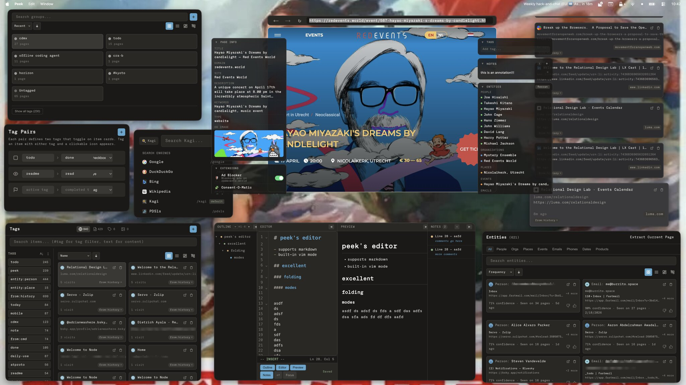
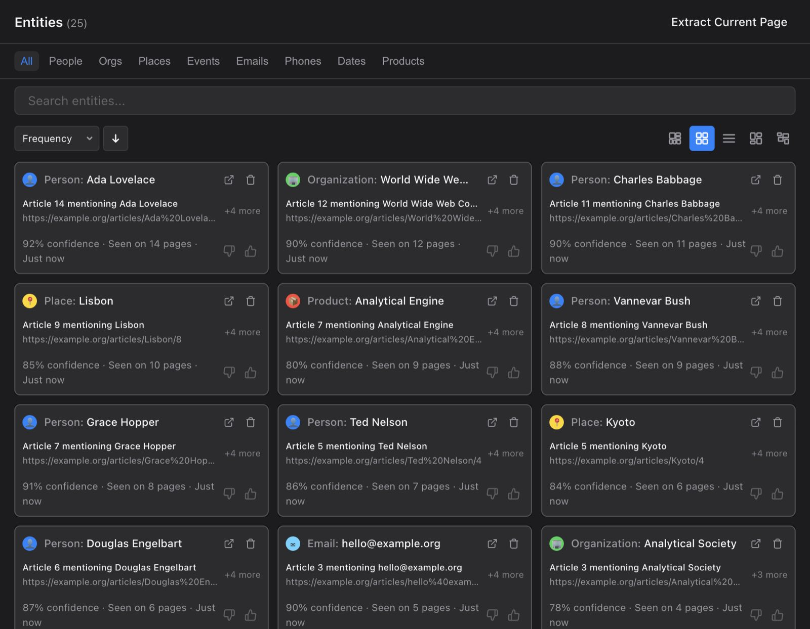
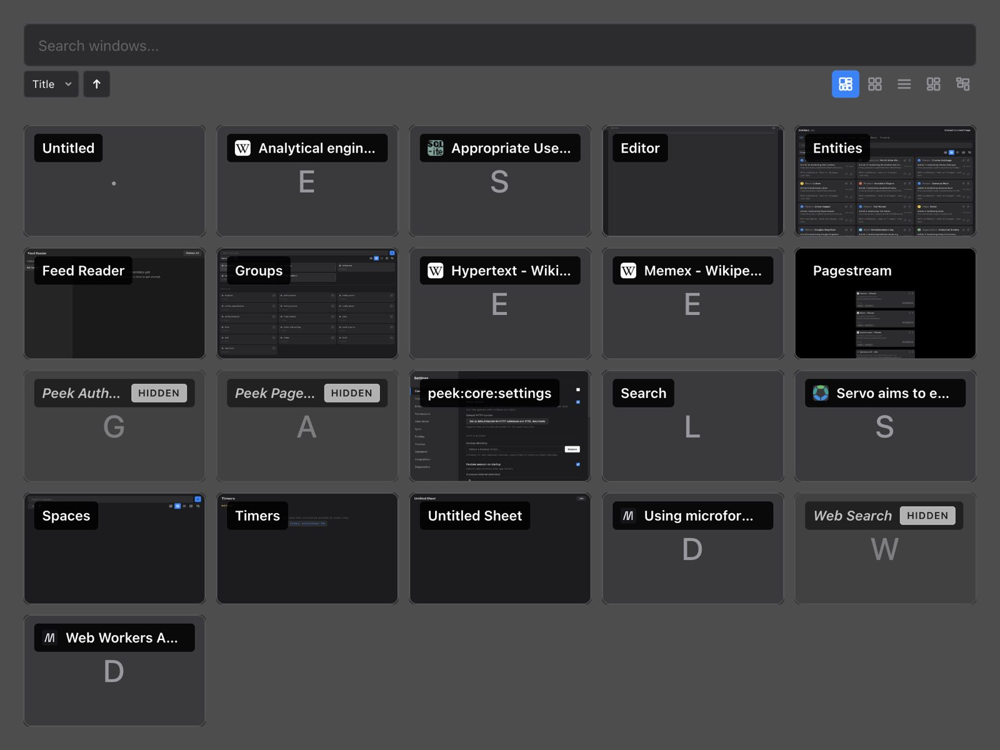
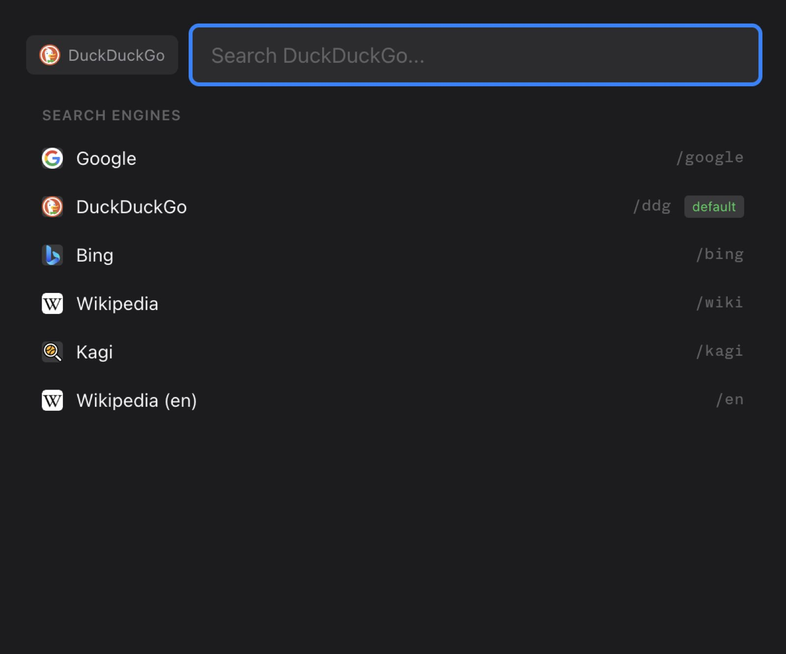
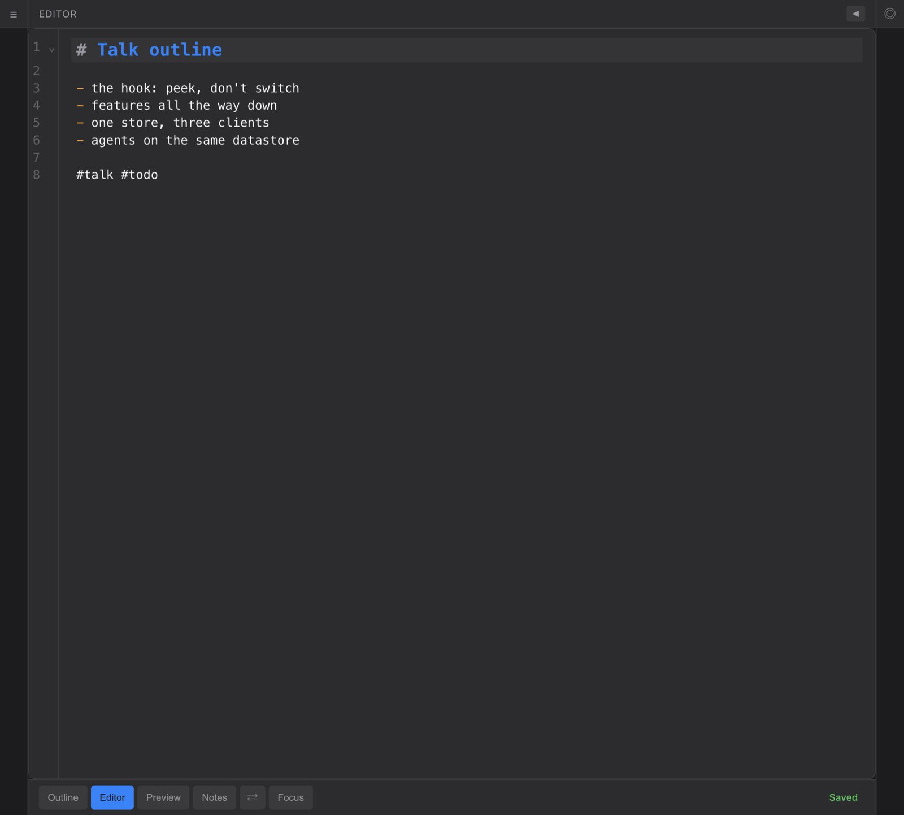
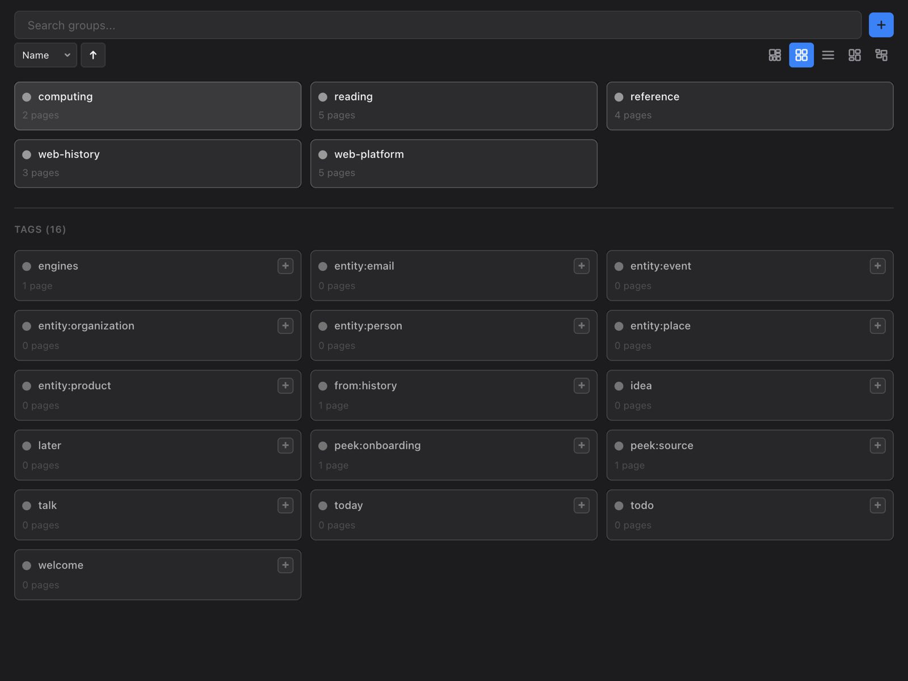
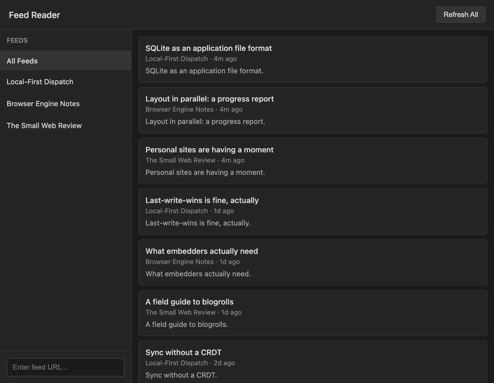
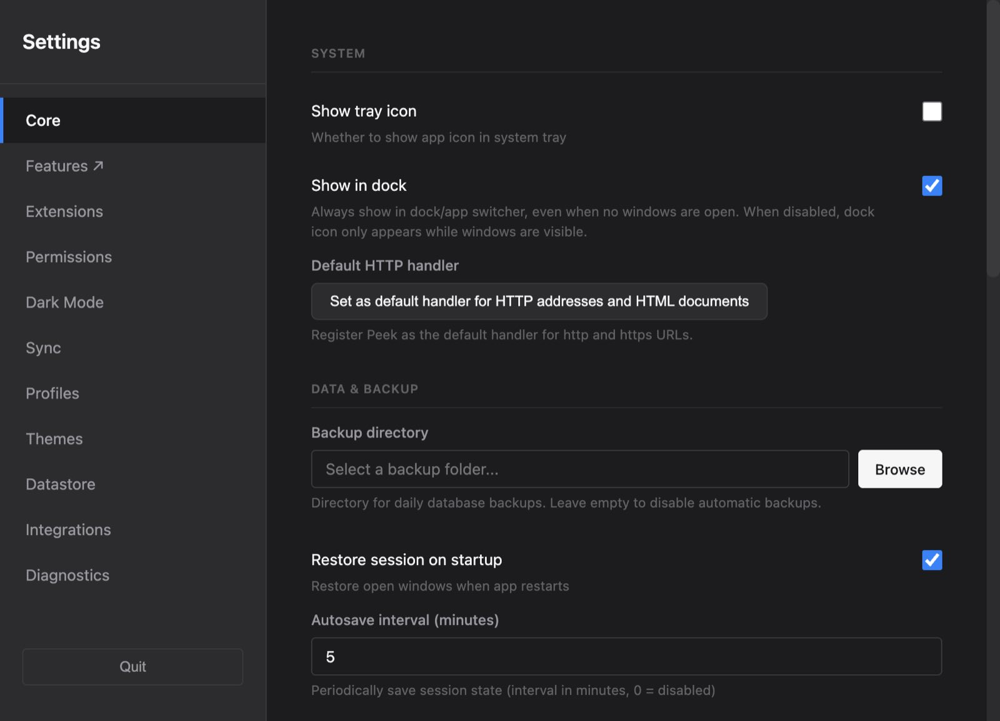

<!--
  SLIDESHOW: open peek-talk-slides.html (same folder) — it renders THIS file as slides.
  Slide breaks are headings: every #, ##, or ### begins a new slide; `---` rules are ignored.
  This markdown stays the single source of truth — edit here, reload the page. Arrow keys navigate.
-->

# Peek is a web user agent for using the web where, when, and how you want.

A workbench for the web. A window manager for the web. What you want it to be.

Today's browsers are one-size-fits-all — the whole web crammed into an unmodifiable tabbed window. But we always use the web *with a goal*, and that goal should shape the interface. You should be the driver, creator, maker, shaper of it — not the browser vendor.

## Peek is NOT a browser.

No tabs, no windows in the tabbed-browser sense. It drops a lot of browser detail you don't notice until it's missing. It's a different kind of application.

<svg viewBox="0 0 480 280" width="100%" style="max-width:33rem;height:auto" role="img" aria-label="Venn diagram: a browser and Peek overlap only where both open web pages">
<circle cx="180" cy="150" r="120" style="fill:var(--text-2);fill-opacity:0.15;stroke:var(--text-2);stroke-width:2.5"/>
<circle cx="300" cy="150" r="120" style="fill:var(--accent);fill-opacity:0.15;stroke:var(--accent);stroke-width:2.5"/>
<text x="108" y="150" text-anchor="middle" style="fill:var(--text);font:700 27px var(--sans)">Browser</text>
<text x="372" y="150" text-anchor="middle" style="fill:var(--accent);font:700 27px var(--sans)">Peek</text>
<text x="240" y="144" text-anchor="middle" style="fill:var(--text);font:600 16px var(--sans)">opens</text>
<text x="240" y="165" text-anchor="middle" style="fill:var(--text);font:600 16px var(--sans)">web pages</text>
</svg>

## Peek is a concept preview — NOT safe for daily use yet.

- A proof of concept.
- No security audit.
- The security model and its UI are still undetermined.
- A research vehicle, not your daily browser.

## Where it comes from

I spent 2006–2019 at Mozilla, and Peek carries pieces of four things I worked near:

- **Awesomebar** — infinite history + a personal local search index.
- **Ubiquity** — natural-language commands that chain.
- **Jetpack** — web-centric extensibility.
- **Panorama / TabCandy** — web pages as *groups*, not tabs.

Peek literally began as a browser extension: peek at a favorite page via a hotkey into a chromeless modal, ESC to close. I abandoned that because extension APIs kept getting more limited and you couldn't build the UX. The only way to build the ideal web user agent is to make it an application. So the extension survives only as a sync/import satellite.

## What the design chases

- Feels like home: trust, comfort, control.
- Continuous instances of magical mind-reading.
- Sleep at night because no idea, and nothing you saw, is ever lost.
- **Create, save, classify at the speed of thought.**

The magic is engineered: frecency everywhere, all the time. Your actions are training data for sorting. The thing you were thinking of is already at the top of the list. *(Frecency = frequency + recency.)*

# No crazy stuff here

- No CRDTs.
- No weird datastores or data structures.
- No spatial canvas.
- No AI.
- No editing-the-app-while-it-runs.

It's a spectrum of building blocks for browser-like mini-apps — a *meta* web user agent. The plain foundation you build your own crazy stuff on top of.

# Small core. The features *are* the functionality.

Browsers are a big monolithic core with a bolted-on extension API. Peek inverts it: a **minimal core**, and features that *are* the functionality — not extending it.

I say "features" deliberately, not "extensions" — *extend* implies a large core you can't change. The implementation term is **tiles**. Features don't extend core functionality; they are it.

## It took five iterations to get here

1. All Electron / privileged JS.
2. Each feature a separate web app + a tiny custom API + one orchestrator.
3. All features bundled into one web app.
4. MVP core loading features into an opaque origin.
5. **Current:** each feature its own BrowserWindow on its own `peek://` origin — one renderer mechanic for every feature, and for the core renderers too.

## IZUI — enter from anywhere, ESC to go back

Inverted Zooming User Interface. Normal zooming UIs start at a root and zoom *in*. IZUI inverts it: you **enter the window stack at any point** — often from outside the app via a global hotkey — and every interface zooms *out* via ESC.

- **Transient** windows (invoked from another app): ESC closes immediately, focus returns to the previous app.
- **Active** windows (invoked inside Peek): ESC navigates internally, never closes.
- Transient-ness propagates to child windows.

> Demo: from Safari, hit Opt+Space, act in the peek, press ESC — back in Safari exactly where you left off.

## The values

- Files, not arcane opaque formats. Metadata can be weird non-file, as long as it's consistent.
- External systems require consent to touch my stuff.
- A web user agent should be bounded by the user, not by browser-vendor business models.
- Windows and tabs should have died a long time ago.
- Security UI must clearly articulate risks and trade-offs; users own the decisions.
- html+js+css need not ship bundled with http+dns+ssl — that trust model isn't a required starting point.

## Capability security, enforced by construction

Every tile **declares** what it needs in `manifest.json`. At load, the main process mints a per-window **capability token**, revoked at unload. Grants are allowlisted and granular:

- network = per-domain allowlist
- datastore = per-table allowlist
- filesystem = per-path globs (builtin-only)
- pubsub = scopes + topic allowlist

`sync` and `filesystem` are builtin-only. Core renderers get a `trustedBuiltin` grant that short-circuits checks — but the bypass is explicit and grep-able at every call site.

## Every IPC frame runs a 6-step gate

Before any `tile:*` handler fires:

1. channel allowlisted
2. sender frame matches the token owner *(closes forged-token-via-XSS)*
3. payload schema valid — hand-rolled shape checks (~5µs; Zod/Ajv is too slow for the per-frame budget)
4. token valid + capability granted
5. tile is in a dispatchable lifecycle state
6. sender role allowlisted

Dev mode adds two bypass detectors that monkeypatch `WebContents.send` and `BrowserWindow.loadURL`, so any back-door attempt is a loud assertion failure, not a silent bug.

## State machines instead of timing hacks

Four explicit FSMs replaced ad-hoc sleeps, polling, visibilitychange listeners, and retry hacks. Each rules out a whole class of bugs and is unit-testable as a pure function:

1. **Tile lifecycle** — *when* a tile is alive.
2. **PubSub** — *what* messages flow in each state.
3. **Cmd panel** — the command-bar UI states.
4. **Window kernel** — open, close, focus, raise, Escape and dismissal, decided in one place.

Window placement is also pure: bounds are a *derived projection* of intent against live display state, never stored as truth, never consulting cursor position.

## The API surface is small on purpose

Everything a tile sees is `window.app`. The design question was: what's the *minimum* capability set a tile needs? Namespaces: window, shortcuts, pubsub, commands, datastore, escape, izui, filesystem, settings, theme, sync, profiles, network, session, rules, oauth, permissions.

Small and portable — features built on it could run in other environments with minimal adaptation.

## Sharp edges I learned the hard way

- **`tile-preload` must stay `.cts` (CommonJS).** `.ts` emits ESM under `NodeNext`, and the Electron sandbox preload **silently rejects ESM** — empty `window.app`, every tile broken, no error.
- **`renderer/` (the core renderer, served at `peek://app/`) is backend-agnostic** — must run unchanged under Electron *and* Tauri. Never modify without review.
- **Electron eats ESC at the main-process `before-input-event`** — DOM ESC listeners in renderers are dead code. ESC arrives via IPC to an `onEscape` handler.
- **Linux/Wayland forbids global hotkeys when backgrounded** — `globalShortcut.register()` returns false silently.
- Requires **Electron 43, Node 24+.** Electron is by far the best option today; there's nothing else remotely suited yet.

## Scale

~3,190 tests across 6 runners, ~10 min wall-clock (including ~1,950 main-process unit tests). 180+ package.json scripts. MIT. The only remote is Tangled, whose CI runs checks on every push and builds a Linux AppImage on release tags; Railway deploys are manual.

# Three clients, one sync contract

- **Desktop** (Electron) — the workbench.
- **Mobile** (Tauri "Peek Save") — capture-focused, with a Swift share extension.
- **Extension** (MV3) — one-way browser import.

All three speak a shared sync schema (`packages/schema`) through a shared sync engine (`packages/sync`) to a passive Hono/SQLite store on Railway (`apps/server`). `packages/integration-tests` proves the whole mesh converges.

## The apps

- **desktop — Electron, the flagship.** The whole tile model, capabilities, IZUI, the FSMs, cmd bar, editor, entities, MCP. Data in SQLite via Node's built-in `node:sqlite`.
- **mobile — Tauri "Peek Save" (iOS + Android).** A save/capture + browse companion, not the full workbench. React + TS + Vite front, Rust + Tauri v2 back, a shared `peek-core` Rust crate. The iOS Share Extension is custom Swift, running the same `peek-core` via UniFFI against the same App Group SQLite.
- **server — Hono on Railway.** A passive sync+store service I use daily. Multi-user or single-user self-host; Bearer keys, SHA-256 hashed. Doesn't implement the Peek API — it shares the schema/sync contract, plus a tag-scoped item API that lets MCP clients work against it remotely.
- **extension — MV3 (Chrome + Firefox).** No build step. Sync, profiles, and one-way browser → Peek import (bookmarks/tabs/history, each tagged `from:*`). The spiritual heir to the original Peek, now a satellite.
- **tauri-desktop — Rust desktop, off the critical path.** Months out of date. Exists only as proof the core is backend-agnostic. Don't demo.
- **packages** — `schema` (canonical `v1.json`, validated on startup), `sync` (the shared JS engine), `capabilities` (the tile capability model), `integration-tests` (where the multi-device promise is actually verified).

## How it syncs

Hub-and-spoke, **server is source of truth**, last-write-wins on `updatedAt`. Local-first, not peer-to-peer, not CRDT. Desktop and mobile each hold local SQLite; all push/pull via the server REST API.

**Transport (live in prod):** Hono + `node:sqlite` on Railway. Multi-user or single-user self-host; Bearer tokens, SHA-256-hashed. Two version gates — `DATASTORE_VERSION` (schema shape) + `PROTOCOL_VERSION` (wire format) — return HTTP 409 on mismatch (lenient about missing headers, strict about mismatched).

Per-item sync metadata (`_sync: {createdBy, modifiedBy, …}`) lives *inside* the item's metadata JSON so it survives the trip. Device IDs are raw UUIDs.

## Sync: conflict handling

**Conflict handling:** pull matches local by `syncId`, inserts/updates/skips by recency, soft-deletes on tombstone. Push: items where `syncedAt=0 OR updatedAt>syncedAt`. Tombstones propagate deletes (never hard-deleted by sync). Pulls arrive in pages, and `item_events` push too, so entity sightings sync.

**Local-only (not synced):** frecencyScore, title, domain, favicon, visitCount. Tag color and hierarchy do sync.

## Sync: the wrinkles

**The same protocol is re-implemented in FOUR places:** unified JS `SyncEngine` (mobile-web/extension), `apps/desktop/main/sync.ts` (Electron), plus Rust in Tauri-desktop and mobile. A recurring risk.

**Known limitations:** failed pushes retry on the next run; items the server permanently rejects are parked and counted. Mobile runs an older schema shape, deferred because migrating means synchronized ~4,000-line Rust + ~2,000-line Swift changes — but sync works anyway because the wire format (JSON) is independent of the local schema.

**Testing:** a clean-room three-way E2E (server + desktop + iOS-simulator) covering tombstone propagation.
## Profiles

Each is an isolated workspace:

- its own SQLite DB
- its own Chromium session
- its own sync config

Production uses `default`; dev builds (`yarn start`) always use `dev`, isolated from prod data. Switching requires a restart.

# Classification at the center

It's how "create, save, classify at the speed of thought" and "magical mind-reading" become real — turning the unstructured web into a personal, queryable knowledge store. Peek classifies at three layers.

## Layer A — item type (structural, on capture)

One unified `items` table, discriminated by a hard `type` CHECK constraint: `url, text, tagset, image, series, feed, entity, event`. The creator picks the type — browser capture → `url`, note → `text`, RSS → `feed`. The coarse cut.

## Layer B — tags (heuristic, rule-driven)

Tags are the primary categorization. Auto-applied provenance tags on import (`from:history`, `from:tab`, `from:bookmark`). Groups are "tags promoted to a group." Hashtags (`#word`) become tags.

The **rules engine** is declarative classify-on-event: an event `topic` + a JSON `match` predicate → a `scriptId`. Rule sources: `manifest` (feature-declared, id = content hash), `user`, or `runtime`. This lets features react to captured content *without staying resident* — e.g. entities declares rules on `page:content-ready` and `item:created`.

## Layer C — entity type (heuristics + a local name DB)

Extracted names get classified into a typed taxonomy: `person, organization, place, event, product, creative_work, email, phone, date, tracking_number, price`.

This is **rules + heuristics + a shipped local name database — no ML, no remote service.** It runs client-side on the desktop in a lazy background tile:

- **Schema.org type map** — ~70 JSON-LD `@type` strings folded into the 11 entity types.
- **Name-pattern heuristics** (pure JS): org suffixes, honorifics → person, CamelCase → org/brand, ALL_CAPS → org, `The X` → org. Each returns `{likelyType, confidence, reason}`.
- **Local name DB** — ~2,000 first names + ~1,000 surnames, O(1) Set lookups.
- **`validateEntityType`** is the gate — it can reject or re-type a misclassification (a JSON-LD "Person" named "IndieWeb" → organization, confidence ×0.8), plus a ~60-name blocklist, a min-length filter, and a 0.7 threshold.

It turns passive browsing into a typed, self-classifying knowledge base with no user effort.

## Entities: shipped vs. researched

**Shipped:** extraction + typed classification + storage + a browser UI. Three extractors run in parallel (JSON-LD/OG/microdata; h-card/h-event; regex for emails/phones/addresses/tracking/prices). Entities *are* items; each sighting is an `item_events` row, so "which pages mention X" and "which entities on page Y" are already derivable. Thumbs-up/down suppresses.

**Research/design only (confirmed absent from code):** the entity **correlation graph** — co-occurrence scored with PMI/NPMI, temporal decay, clustering into groups like {Elon Musk, Tesla, SpaceX, SEC}, a force-directed view. And **Wikidata validation** — async P31 instance-of checks. Entities-as-live is real; the knowledge-graph is the next chapter.

## Entities on desktop

Feature "Entity Recognition" v3.0.0, `builtin`, a **lazy background tile** woken by the rules engine (`page:content-ready` / `item:created`-URL). Debounced (2s), cooldowned (1h). Three extractors in parallel — structured-data (conf 0.85–0.9), microformats (0.9–0.95), regex (0.6–0.9).

Dedup by normalized name + aliases; thumbs-down suppresses. UX: an entities browser window + per-page display.

# Mobile: "Peek Save"

Save and organize URLs, notes, images, and tag-sets with frecency scoring. A capture-and-browse companion, not the full workbench. React 19 + Vite front; Rust + Tauri v2 back; a shared `peek-core` Rust crate.

The key choice: `peek-core` compiles into both the main app *and* the iOS Share Extension via UniFFI — so a save from the share sheet and a save from the app run identical logic against the same App Group SQLite.

## Item types and capture

Four types, tabbed browse: Pages (URLs), Notes (inline `#hashtags`, markdown, live checkboxes), Tag Sets (reusable tag combos), Images (thumbnails, mime, dimensions).

Capture paths:
- Global quick-add bar — one field that becomes a page, a #tagged note, or a tagset by content. Draft persisted.
- Camera → image item.
- **iOS Share Extension** (custom Swift) — save from any app's share sheet without opening the app, straight into the shared SQLite via UniFFI.
- **Android share intents** — persisted to a file queue, drained on next focus.

## Frecency intelligence

Frecency-scored tag suggestions (`frequency × 10 × decay`). **Domain-affinity boost** — tags used before on the same domain get 2×, so relevant tags surface first. URL de-dup with set-union tag merge on re-save.

**Triage widgets** — configurable per-card tag pairs: todo/done, readme/read, today/later. Each renders only when the item already carries one of the pair's tags.

## Viewing and browse

Native in-app WebView via a custom Tauri plugin, Reader mode, Open in Safari, and **offline reading** (download a page, read it later, no network). Opens feed frecency/history.

Browse: SQL-side filtering/sorting/pagination (30/page, infinite scroll), search + tag chips + sort, config-driven hiding of archived/`from:history` rows, pull-to-refresh, swipe-to-dismiss editors.

## Mobile sync

Bidirectional, per-bucket routed by `synced_profile_id`, LWW on `updated_at`, offline-aware. **Selective:** only user-curated types (`url/text/tagset/image`) push; locally-derived types (entity/series/feed) are pulled, never pushed.

> Demo: in Safari, Share → "Peek Save" → the custom share UI → pick/create frecency-sorted tags (dup detection merges tags if already saved) → save, no app launch.

**Not shipped (roadmap):** WebView bottom-sheet presentation (current is full-screen), a Vision-framework image-analysis plugin, a Safari Web Extension one-tap save.

# Desktop deep dive

The desktop app is where the tile model, capabilities, IZUI, the FSMs, the cmd bar, the editor, entities, and MCP all live.

## Minimal core, not a browser

Peek is a minimal *platform* core; browsing is one feature bolted onto it. Instead of "a browser that runs extensions," it's "a small trusted runtime + capability system on which *everything* — including web page rendering — is a tile."

**Features (tiles):** web page rendering, websearch, peeks, slides, groups, tags, editor, entities, mcp-server, windows, and dozens more. Each lives in `features/<id>/` with a `manifest.json`.

**Core (`renderer/`, served at `peek://app/` — no manifest, no sandbox):**
- **bgWindow** — the orchestrator. Cmd registry, page controller, HUD, session, pubsub. Every publish reaches it.
- **cmd, page, hud** — the three surfaces, consolidated into the core renderer.
- The **main process** — datastore, IPC, the `peek://` protocol, the lifecycle/pubsub/gate machinery.

## Why cmd/page/hud can't be tiles

1. They can't be uninstalled — no cmd = no invocation, no page = no rendering.
2. They can't be published — a cmd on atproto makes no sense; they *are* the interface.
3. They need deep platform integration — sandboxing them is actively harmful.
4. The capability model is for *untrusted* code and breaks down when the code *is* the platform.

The tile model, bgWindow-as-core, `trustedBuiltin`, and renderer consolidation are **shipped** (v1 removed April 2026). cmd/page/hud have moved out of `features/` into `renderer/`. Extracting that core into a package shared across backends is **planned**, not done — don't present it as done.

## The cross-backend API

The API is **`window.app`**, exposed to *every* `peek://` renderer by the preload. It's implemented by both the Electron and Tauri backends, so frontend code works unchanged across them.

The stable surface:
- `window.*` — open/close/hide/show/focus/list; animate, always-on-top. Options: key, geometry, modal, transparent, decorations, keepLive, escapeMode.
- `datastore.*` — items/visits/tags/generic-table/stats.
- `publish/subscribe` + scopes.
- `shortcuts` (local + global), `commands`, `theme`, `escape.onEscape`, `izui`, `log`, `quit/restart`, `settings`.
- Uniform envelope everywhere: `{ success, data?, error? }`.

Feature code only ever touches `window.app.*` — bare Electron IPC is a smell. Each backend ships its own preload of the identical shape; backend-specific mechanics live behind the API in per-backend glue.

*Caveat:* the tile runtime itself (launcher, preload, csp, ipc, tokens) is currently Electron-specific — Tauri needs equivalents. Future work, not blocking.

## Datastore: node:sqlite

Synchronous SQLite in the main process. Renderers go through IPC via `window.app.datastore.*`. DB file: `{app_data}/{profile}/datastore.sqlite`. Canonical schema at `packages/schema/v1.json`.

*(TinyBase is legacy — it survives only as a one-time migration path. No live dependency.)*

Core tables:
- **`items`** — all content. id, type, content, mimeType, metadata (JSON), sync columns, timestamps, soft-delete, starred, archived, visitCount, frecencyScore, plus denormalized title/domain/favicon.
- **`item_visits`** — history, local-only, not synced (with visit chaining).
- **`tags`** + **`item_tags`** junction.
- **`item_events`** — append-only observations (entity sightings live here).
- **`extension_settings`** — key/value for feature + core settings.

## Reactivity without a reactive store

There's no reactive-store binding layer. Instead: **SQL is the source of truth; pubsub is the change bus; renderers re-read on event.** Datastore handlers publish domain events (`item:created`, `tag:created`, `sync:pull-completed`, …); UIs subscribe and re-query.

Gotcha: a direct `tagItem()` doesn't publish — use `tagItemAndPublish()` for reactive updates.

## The four FSMs

- **Tile lifecycle** (`tile-lifecycle.ts` + pure `tile-fsm.ts`): *when* a tile is alive. Manifest cached on `registered` so a tile's commands appear in the palette before it ever runs; token minted on `ready`, revoked on unload/crash; one code path for window creation.
- **PubSub** (`pubsub.ts` + `tile-ipc-gate.ts`): *what* flows in each state. **The token IS the capability handle.** The pubsub path never reads lifecycle state; it runs `validateToken(t) → grant | null`. Because lifecycle mints/revokes the token exactly on ready/unload, the "checked before or after the state change?" race can't happen. One hub, subscriber-indexed delivery. Every rejection emits telemetry — never silent.
- **Cmd panel** (`renderer/cmd/state-machine.js`, pure): 10 states. Replaces the old "every bug fix adds another boolean flag" model.
- **Window kernel** (`window-kernel.ts`, pure decide/evolve/react): the sole decider of open, close, focus, raise, Escape and dismissal. Property-tested, and checked against a written rulebook (`docs/design/window-rules.md`). It replaced the old window-state engine.

A fifth FSM was written for the *canvas* page-host, which is gone.

## A tile is a feature.

A tile = one HTML file in its own Electron `BrowserWindow`, on its own `peek://{tileId}/` origin, with a capability-gated preload and a strict `tile:*` IPC surface.

No tile "type," no tile "role." Only two axes: **Residency** (resident-at-startup vs lazy) and **Visibility** (shown vs hidden).

## Everything is a feature

From `apps/desktop/CLAUDE.md`: *"Every UI surface — browser tabs, cmd panel, settings, everything — is a tile. There is no tile type or role distinction."*

The core is thin — a loader, an IPC capability gate, a few always-on registries. Almost nothing is baked into the shell: browsing chrome, the command palette, settings panels, the editor, tag management, window switching, OAuth — all features, all loaded the same way as a demo extension.

How radical, concretely:
- The command palette is itself a feature — special-cased only for load order, not privilege.
- Per-feature settings panels are generated at runtime from each feature's own `settings-schema.json`.
- Even dev/diagnostic surfaces (`hello-world`, `debug`, `widget-demo`) ship as real features.

## The tension

This uniformity buys crash containment, origin isolation, one contract for built-ins and third parties alike, hot-reload, and a memory dial (lazy activation).

But it's young. The lifecycle-FSM doc opens by listing real bugs that came from features breaking the policy. "Everything is a feature" only works once the loader, FSM, and capability layers are solid. The hard part isn't the idea; it's making it safe.

## The feature manifest (schema v3)

| Field | Purpose |
|---|---|
| `id` / `name` / `version` | identity; `id` doubles as the `peek://` host |
| `builtin` / `hidden` | ships with Peek / excluded from user lists |
| `tiles[]` | window/iframe surfaces this feature owns |
| `capabilities` | the sandbox contract |
| `commands[]` / `shortcuts[]` | palette + keyboard declarations |
| `rules[]` | declarative pubsub-triggered rules |
| `settingsSchema` | path to `settings-schema.json` |
| `wakeShortcutsFromSettings` | hotkeys come from user settings, not the manifest |

`tiles[]` entries carry: id, url, `role` (workspace/panel/overlay), key, size/title, transparent, frame, focusable, alwaysOnTop, keepLive, `lazy`, `lazyEvents[]`.

## Capabilities: nothing is ambient

A feature must declare everything it touches:
- `pubsub: { scopes, topics }` — **every topic published *or subscribed to* must be listed.** Miss one and it fails silently.
- `datastore: { tables }` — explicit table allowlist.
- `network: { domains }` — fetch allowlist (advisory for builtins, enforced for installed features).
- `window`, `filesystem` (path globs), `dialogs`, boolean flags for commands/shortcuts/settings/sync/oauth/rules/izui, and `features` (only for the feature that manages other features).

**Init contract (a sharp edge):** every tile must `await api.initialize()` before any gated call. Wake handlers must register synchronously in `init()` *before any await* — the ready signal fires on a `setTimeout(0)` that can beat an async init's first await, so a late handler misses the very event that woke the tile.

## Reference features

- **`hello-world/`** — the minimal working tile: the smallest feature that stands on its own, showing the tile → `manifest.json` → `window.app` model end to end. The first thing to read to understand how features work.
- **`example/`** — the reference template. Feature-detects the Peek API, also runs standalone as a plain website, mime-typed command registration, storage fallback, cleanup.
- **`todo/`** — shipped-but-disabled by design: its manifest is `manifest.json.disabled` so discovery walks past it. Re-enabling is a one-line `mv` — shipped-but-off with zero runtime cost, gated by the file's *name*.

## Feature lifecycle: 7 states

| State | Meaning |
|---|---|
| `unregistered` | never installed; no cache row |
| `registered` | manifest parsed + cached; static declarations wired; renderer not loaded |
| `loading` | window created, awaiting the renderer's `tile:ready` |
| `ready` | initialized, token validated, dynamic registrations accepted |
| `visible` | ready + on screen |
| `unloading` | grace window → token revoke → close → cleanup |
| `crashed` | render process died; manual-only relaunch |

Key invariant: **command dispatch guarantees state ≥ ready** — dispatching to a not-yet-loaded tile forces `registered→loading→ready` first, and failure surfaces as an explicit error, never a silent spinner hang. That's the bug that motivated the FSM.

## Lazy activation

The default for most built-ins now — production boot went from 6 windows to 2.

- Lazy = drop `resident: true`; add `lazyEvents: [...]` for event-driven behavior with no commands.
- **Wake triggers:** a `cmd:execute:<command>`, or any topic in `lazyEvents[]`. A matching publish loads the tile, waits for ready, then redelivers the deferred publish.
- **Global hotkeys with no renderer running:** accelerators register at boot even for unloaded tiles; a shortcut can publish a command or wake topic directly.
- **Core semantic wake events:** e.g. `page:search-engine-discovered` wakes `websearch` exactly when a page advertises an OpenSearch descriptor.

**Loading mode:** every feature is its own tile window and process — full crash isolation. The shared iframe host for built-ins is gone. `cmd` is core (`renderer/cmd/`), loads first, synchronously, and can't be disabled.

## The features I use

35 dirs under `features/`; 34 active, `todo` disabled. (Plus theme features — `theme-peek`, `theme-shichijuni`, which keys colors to Japan's 72 traditional micro-seasons.)

| Feature | What it does | Key |
|---|---|---|
| **cmd** | The command palette; core, not a feature dir; loads first, can't be disabled | Opt+Space / Cmd+K |
| **groups** | Tag-based page grouping (Panorama heritage) | — |
| **spaces** | Workspace mode, auto-tagging, session mgmt | — |
| **windows** | Full-screen window switcher (only `izui:true`) | Cmd+Shift+W |
| **peeks** | Chromeless modal web windows | Opt+0–9 |
| **slides** | Edge-anchored slide-in panels | Opt+arrows |
| **editor** | Markdown editor: outline, live preview, vim | Cmd+E |
| **entities** | Auto-extract people/places/orgs from pages | — |
| **tags** / **tag-actions** | Tag viz + tag-triggered actions | — |
| **search** / **lists** | Search items, tags, history | — |
| **pagestream** | Chat-like navigational history | — |
| **websearch** | Palette search w/ engine discovery | — |
| **feeds** | RSS/Atom reader | — |
| **timers** | Countdown/alarm/stopwatch/interval | — |
| **scripts** | Userscripts (Tampermonkey-ish) | — |
| **lex** | Your AT Protocol identity + data (`oauth`) | — |
| **mcp-server** | Expose Peek data to Claude Code (`hidden`) | — |
| **features-manager** | Browse/install/publish features | — |

AT Protocol feature publishing is real — `features-manager` has `atproto` and `url` sources with real `bsky.network`/`plc.directory` grants.

## Global hotkeys that peek but don't steal focus

The core bet: a global hotkey summons the palette or a peek **without** switching your active app or macOS Space. You're in Safari, hit the hotkey, a small window appears on top, act, it vanishes, you're back with zero context-switch cost. Default: **Option+Space** (Cmd/Ctrl+Space on Linux, since GNOME reserves Alt+Space).

Three cooperating mechanisms:
1. Modal windows are macOS **`type: 'panel'`** — `show()`/`focus()` skip `activateIgnoringOtherApps`.
2. **`setVisibleOnAllWorkspaces`** on modal/alwaysOnTop windows — visible on any Space.
3. **Headless-safe show discipline** — real show does `show()` + `contentWC.focus()`; headless does `showInactive()` + `opacity:0`. Getting this wrong is the "dead focus" bug (NSBeep, no first responder).

The same holds for pages: a URL opened from the palette over another app takes the keyboard without activating Peek. ESC sets the page aside, and it comes back the next time Peek activates.

## The upstream walls

**The macOS Spaces bug:** on Space 2 you hit the hotkey and macOS yanks you to Space 1. `setVisibleOnAllWorkspaces(true)` sets `CanJoinAllSpaces` but not `MoveToActiveSpace` — and Electron doesn't expose the latter flag at all (electron/electron#8734, open since 2016). A real, cited, unresolved gap.

**Wayland: global hotkeys are impossible by design.** Peek ships three layered answers: try global anyway (works on macOS/Windows/X11); register every global shortcut *also* as a local one; and CLI-verb dispatch — a Unix-socket daemon + a tiny Node helper you bind to a key in your *own* DE settings. The OS owns the keygrab. Linux ships as an AppImage, built in CI on release tags. The "correct" XDG portal was investigated and rejected (GNOME backend not shipping on target LTSes).

## Why peeks always land right

Four placement modes only: `centered` (peeks/cmd), `edge` (slides), `proportional` (user-dragged), `parent-centered` (popups). **Intent is the source of truth; bounds are a derived projection** via a pure `project()`, called synchronously on every display add/remove. Display selection never consults cursor position — it uses the OS primary display. That's why "peek opens on your main screen" is reliable on multi-monitor.

> Demo: summon the cmd bar with Opt+Space over another app, act, dismiss — your active app and Space never change.

## Peeks and slides

Both are transient, modal, quick-access windows hosting a *real web page*, bound to a hotkey. Only placement differs:

| | Peeks | Slides |
|---|---|---|
| Placement | `centered` | `edge` |
| Trigger | Option+0–9 | Option+arrows |

Both are lazy tiles, woken by `cli:peek-open` / `cli:slide-open`, with real hotkeys from user settings (self-healing backfill for migrated profiles).

> Demo: Opt+0 peeks a page centered; Opt+Up slides one in from the edge; ESC dismisses either. (Those two are the only defaults — other digits and directions need configuring first.)

## Cmd → anything

The palette isn't just a launcher — a command's `execute()` result decides what opens next:
- **no output** → panel closes (silent success — a known UX gap).
- **single item** → opens the editor (a new `note` lands here; only a tagset closes silently).
- **array** → an arrow-navigable list + preview pane, inside the panel.
- **chainable output** (declares a MIME another command accepts) → chain mode.
- Commands can also open a full tile window, or fire a declarative pubsub event.

So one `Opt+Space` entry point can terminate in a tagset saved silently, a full window, an in-panel array browser, a markdown editor, or a multi-step pipeline.

## The window switcher

IZUI governs how a window behaves based on *how it was invoked*: `active` (already in Peek), `transient` (from another app — ESC closes, focus returns), `overlay` (full-screen, on top of everything), `idle`. Transient state propagates down a session's window tree.

The switcher (`features/windows/`) is a transparent, alwaysOnTop overlay tile:
- **Invocation:** Cmd/Ctrl+Shift+W, *or* **ESC** while Peek is the active app — from a focused page, or when no Peek window holds the keyboard. The Escape grab is armed only while Peek is active, so it never eats ESC from another app. Two exceptions: ESC never opens the switcher over a fullscreen window, and a page reached from another app closes instead.
- **Shows:** every open window as a card — favicon, title, thumbnail (real screenshot or a hostname placeholder), a Hidden badge.
- **Navigation:** vim `hjkl` or arrows; Enter activates; `/` searches; two view modes (Exposé-style `fit` default, `columns`). Pre-selects the previously focused window.

> Demo: switch to Peek with a page focused, press ESC → the switcher zooms out over everything; hjkl to a card, Enter to jump.

## The cmd bar

A small translucent pill (60px), a keepLive window created once, reset on each show. Files: `panel.js` (DOM), `state-machine.js` (pure 10-state FSM), `commands.js` (cache), `completers.js` (param suggestions).

The 10 states: `IDLE → TYPING → RESULTS_OPEN → PARAM_MODE → EXECUTING → {OUTPUT_SELECTION, CHAIN_MODE, CHAIN_POPUP} → CLOSING`, plus `ERROR`.

- **TYPING** — two-tone ghost text (bold typed, dim match tail). Dropdown doesn't auto-open; you press ArrowDown (a flagged discoverability gap).
- **RESULTS_OPEN** — up to ~50 matches, scope badges, chain MIME badges.
- **PARAM_MODE** — via Tab or trailing space; suggestions become params. Tab fills, Enter executes.
- **OUTPUT_SELECTION** — array output, arrow-navigable + live preview.

Escape is layered: paramMode → outputSelect → chain → results → clear text → close.

## The cmd bar's open UX gaps

Audited, current, not hidden:
- Nothing in IDLE signals commands exist at all.
- Keyboard-selected vs mouse-hover rows are nearly indistinguishable (opacity-only, bad in dark mode).
- No weight distinction between command name and param text.
- **No success feedback** — a command that saves silently just closes (a `result.message` exists but is discarded).
- Chaining is real but nearly undiscoverable.

## Commands I use a lot

73 commands across 35 feature dirs, plus a set baked into the cmd module. Built-in: `note`/`notes` (the core capture verb), `url`/`urls`, `edit`, `email`, `bookmark`, `history`, `containertab`, `sendtowindow`, `item-query`.

| Command | What it does | Key |
|---|---|---|
| `note` / `notes` | Save/list notes — the core capture verb | — |
| `windows` | The window switcher | Cmd+Shift+W |
| `groups`, `open/switch group` | Saved tab-group sessions | — |
| `open/switch space` | Heavier workspace snapshots | — |
| `tag`, `tags`, `untag`, `tagset` | Tagging — a first-class primitive | — |
| `lists`, `search`, `pagestream` | Search items/tags/history | — |
| `editor` | Markdown editor | Cmd+E |
| `web search`, `kagi`/`google`/`ddg` | Param-mode web search | — |
| `timer countdown/alarm/…` | Typed-param timers (`30m`, `6pm`) | — |
| `csv`, `save`, `save as note` | File I/O + chain targets | — |
| `features`, `browse/publish feature` | In-app marketplace + self-update | — |
| `mcp server setup` | Wire Claude Code to Peek | — |
| `lex` | AT Protocol identity | — |

## The editor

A **markdown** editor (not rich-text, not block-based) on CodeMirror 6, three panels. `Cmd/Ctrl+E`.

Layout: outline sidebar (TOC, click to jump) · CodeMirror center (highlighting, folding, search) · live preview right. Plus vim mode (persisted) and focus mode (hides sidebars, ESC exits). It edits notes/items from the datastore, opened via `editor:open` or as the terminal surface of a command returning an item. A lazy tile, historically fragile (a command firing before the tile loaded used to drop the event; fixed via lazy-event interceptors).

**Vim fidelity:** implemented and tested (33 Playwright tests) — folding, vim fold commands, a status line. Missing (high priority): text objects, char search (`f`/`t`), word search (`*`/`#`), replace mode, ex commands — though some may ship free via the underlying vim dep and just need verification.

## Editor: annotations, highlights, links

Three capabilities that shipped after both editor docs were written, all code-verified:

- **Highlights + Notes pane** — shipped, demoable, Playwright-tested. Select text → `Cmd/Ctrl+Shift+L` marks a persistent colored highlight (6-color palette, positions re-map across edits); a collapsible right-edge Notes pane lists each with an inline note, click-to-jump, two-click delete. *Caveat: highlights persist to renderer `localStorage`, not SQLite — so they don't sync and are tied to that profile.*
- **Clickable links** — shipped, demoable, but rough. `Cmd/Ctrl+click` opens URLs in the viewport. Zero test coverage — demo it, don't lean on it.

## Cmd chaining works today

Mechanically working, discoverability-poor — not broken.

Commands declare `accepts: [mimeTypes]` / `produces: [mimeType]`. Three flavors: producer (`lists`), transformer (`csv`), consumer (`save`). MIME matching supports wildcards. Canonical flow: `list urls` → array → select a row → `csv` → CSV text → `save` → native dialog.

The routing was guard-order-dependent (three tests in tension). Now array output *always* enters OUTPUT_SELECTION first; chain mode is reached only via explicit row selection. Confirmed by `command-chaining.spec.ts` (9 tests) + `cmd-chain.spec.ts`, no `.skip`, inside the gate.

Still open — discoverability: nothing signals "this output is chainable" beyond a tiny MIME badge; the chain indicator shows a raw MIME string; there's no way to *start* a chain except by running a producer and noticing.

> Demo: `list urls` → arrow to a row → Enter → `csv` → `save` — it works live. Just don't claim discoverability is solved.

## 50+ live pages, fast and lean

I routinely keep **40–50+ web pages open at once** — the regime where a normal browser starts to thrash. Peek opens them instantly and holds them on modest memory.

- **Fast to open** — features load lazily (boot dropped 6 windows → 2); a page is one positioned view, not a whole browser shell spun up per tab.
- **Far less memory** — one opaque `WebContentsView` per page: no per-page double-renderer, no always-painting transparent compositor. Idle pages repaint *nothing*, so CPU sits near zero.

## The page host

As of 2026-07, the hybrid page-host is the ONLY one. The legacy transparent-canvas `<webview>` architecture was deleted outright — no flag, no fallback.

Real 46-page prod session, same session before/after:

| Metric (idle, settled) | Canvas | Hybrid | Δ |
|---|---|---|---|
| Renderer processes | 107 | 63 | −41% |
| Renderer RSS | ~15.4 GB | ~10.5 GB | −32% |
| Electron CPU @ idle | ~118% | ~1–3% | eliminated |
| WindowServer CPU @ idle | ~47% | ~12–16% | −68% |
| GPU CPU @ idle | ~33% | ~0% | eliminated |

Old (canvas): a fullscreen *transparent* window hosting chrome beside a `<webview>` = 2 renderer processes per page + always-alpha-composited, ×N pages. New (hybrid): one **opaque, positioned `WebContentsView`** attached directly to its window (keeps its own session+preload so extension compat re-attaches) + a single shared chrome overlay repositioned over the active window.

The idle-CPU collapse is the biggest win: transparent canvases ran a continuous compositor paint loop even when idle; opaque static content has nothing to repaint. All three CPU metrics dropped together.

## Page host: the invariants that replaced the old model

The migration broke almost every focus/ESC/menu assumption. The invariants now live in a pure window kernel (`window-kernel.ts`), property-tested and checked against a written rulebook (`docs/design/window-rules.md`):
- **`getFocusedWindow()` returns `null` for a hybrid host** (a `BaseWindow`, not `BrowserWindow`). So "what's the current window?" is answered by the kernel's own record of which window holds the keyboard, never by Electron. This one broke cmd+W, the global ESC fallback, and window-close resolution.
- **Show discipline:** `show()` + `contentWC.focus()` makes the content view the first responder. Missing that on a re-raise caused "ESC is dead until I click the page."
- Real macOS first-responder behavior is **unobservable in headless runs** — several bugs surfaced only via live `fs-diag` instrumentation in a real `yarn start` session.

The nav chrome (address bar, navbar) is no longer per-page DOM — it's a single shared floating overlay, revealed via a top-edge hover band and hidden otherwise, so pages read as full-bleed content most of the time.

## MCP: Peek as an agent-writable backend

Peek exposes a **Model Context Protocol server** so Claude Code can read/write the *same* SQLite datastore the desktop app uses.

Architecture: `Claude Code ⇄ stdio (JSON-RPC) ⇄ peek-mcp launcher ⇄ server.js ⇄ store/ ⇄ SQLite`. The launcher is an Electron-as-Node wrapper so clients don't need system Node. The local store mirrors `main/datastore.ts` policy — if it diverges, MCP misbehaves.

**Two stores, same 13 tools:** local (the desktop SQLite file) or remote (`peek-mcp-init --remote`, which points the tools at the sync server's scoped item API) — so an agent on a machine with no Peek install still works the same task list.

**13 tools:** 6 read-only always-on (`list_items`, `search_items`, `get_item`, `list_tags`, `list_tasks`, `get_task_context`); 7 mutating, only with `--writes` (`create_item`, `update_item`, `delete_item`, `tag_item`, `untag_item`, `record_event`, `complete_task`).

## MCP: the safety mechanisms

- **`search_items`** is tokenized, ranked, multi-field (title 10 > tag 6 > domain 4 > content 2, frecency tiebreak, returns score + snippet).
- **Git-short-hash id resolution** — any unique leading prefix works; ambiguous prefixes hard-error (mutations never act on a guess).
- **Content windowing** — `get_item` returns the first 4,000 chars so a page-capture can't blow the caller's context.

**Scoping** — `PEEK_MCP_SCOPE_TAG=<scope>` confines a session to items tagged `<scope>` or `<scope>:*`. Reads filter to in-scope; writes force-add the scope; foreign-namespace tags are rejected so an agent can't poison a sibling project; out-of-scope prefix matches read as not-found (no existence leak). Installed per-project via `peek-mcp-init`. In a scoped session, `complete_task` moves a task from `<scope>:todo` to `<scope>:needs-review` — it only reaches `<scope>:done` once a human accepts it.

Env is frozen at spawn — changes need a Claude Code restart. The server self-exits when its config changes so the client respawns with fresh env.

Peek becomes an agent-writable personal knowledge + task backend — in local mode, over the *same* SQLite the human UI reads live. This repo dogfoods it — its own `peek:*` tasks run through these tools.

> Demo: run `peek-mcp-init <scope> --writes` in a project dir, then show Claude Code reading and tagging items in the same store the Peek UI is displaying — human and agent on one live datastore.

## Plus hundreds of micro-tweaks

- Peeks always open on your primary display
- ESC returns focus to the previous app you were using
- Cmd panel scrolls the selected result into view
- Double-click a page to maximize
- Exiting fullscreen restores the prior window size
- Cmd+click a link opens a loaded window, not blank
- Hold and drag anywhere on a page to move its window
- Undo-close reopens the window at its last URL and scroll
- Undo-close-window survives across restarts
- New tab opens a themed page instead of blank white
- Fresh profiles seed onboarding demo content on first launch
- WhatsApp Web loads via a clean Chrome user-agent
- Web pages close on the first ESC press
- ESC while editing text no longer opens the window switcher
- Left-edge swipe navigates back on mobile
- Tap an image to view it fullscreen on mobile
- Pull down to refresh and sync on mobile
- Periodic auto-sync keeps data fresh in the background
- Font size slider with realtime preview
- Clear buttons on every input field and textarea
- Restart restores and re-focuses your last-focused window
- Windows switcher highlights the window you were just on
- Reopened windows re-center on screen
- Cmd+W closes the whole page, chrome overlay included
- ESC at the root opens the windows switcher
- ESC no longer closes your Settings window
- ESC closes child windows immediately
- ESC in an annotation textarea closes it
- Focus returns to the previous app when the last window closes
- Overlay stops stealing focus when the app is backgrounded
- Windows switcher closes when the app loses focus
- Navbar and panels stay inert without OS focus
- Devtools no longer steals focus when opened
- Closing windows leaves your other Spaces untouched
- Cmd+L reveals the address bar, and re-reveals on repeat
- Navbar auto-hides when your cursor leaves it
- Navbar stops flickering as the cursor crosses its edge
- Hovering the top edge reveals the navbar
- No white flash when the navbar shows or hides
- Webviews keep rounded corners for edge-to-edge display
- Resize handles reachable even when the window is maximized
- Maximize restores to the exact pre-maximize size
- Downloading from a page no longer closes its window
- Download filenames are sanitized and auto-numbered
- Native notification when a download completes
- Find-in-page, title, and favicon live in the navbar
- Inline URL ghost text completes the domain as you type
- Cursor stays visible when typing past the input width
- Visited URLs appear as frecency-ranked inline suggestions
- Shift-Tab cycles command suggestions backward
- ESC clears the command text before closing the palette
- Run the inline suggestion by pressing Enter
- Command palette results sort with a stable tiebreaker
- Autosave for notes and tag-only edits
- Full-screen-height editor with working resizers
- Tag input splits entries on commas
- Tag input refocuses after adding or removing a tag
- Toasts, validation, and discard confirmation when editing
- Selection contrast and active-line visibility improved
- Syntax highlighting readable in dark mode
- Stops highlighting matching text on other lines
- Keyboard height detection keeps buttons above the keyboard
- Editor overlays fill up to the keyboard
- Vim :w saves the file
- Markdown lists auto-continue bullets on the next line
- Reader mode and offline reading for notes
- HUD, command palette, and panels follow light/dark theme
- Web page backgrounds match the system theme
- Themes switch live from the command palette
- Open windows live-reload on theme change
- Three-tier dark mode for web pages
- Tag chips show usage counts
- Link icons on cards appear only on hover
- Muted tag accent colors in dark theme
- Tag suggestions only list tags actually in use
- No list flash on every search keystroke
- Today/Later toggle on mobile
- Two-state offline icon: solid downloaded, hollow pending
- Fixed mobile header bounce and cursor jumps
- iOS keyboard accessory bar disabled
- Notch and safe-area padding gated to iOS only
- Android and Linux dark mode follow the system color scheme
- Share extension for text and images with a share toast
- History items hidden from the default list view
- Hold-to-drag delay tuned down to 0.3s
- Drag preserves text selection and drag-and-drop
- Click-and-hold drags frameless windows
- Webview auto-focuses after the page loads
- Stuck "Loading..." titles backfill to the hostname
- Permission prompt shows favicon, nav-count badge, and timestamps
- Clear-all button resets the permissions list
- Removed conflicting global hotkeys (pagestream, composer, groups)
- Slides and peeks dismiss when you switch apps
- Slide and peek chrome no longer flashes before activation
- Focused window shows a colored screen border
- Space color dot marks each window's group
- Editor gains tighter padding and edge-to-edge card space
- Card grid gains sorting and view-mode toggles

## Groups

## Feed reader

## Settings

# Parking lot

Extra detail, kept back for Q&A.

## Monorepo layout

`apps/{desktop, mobile, server, extension, tauri-desktop}` + `packages/{schema, sync, capabilities, integration-tests}`.

*(README/DEVELOPMENT.md still describe an older `app/` + `backend/` layout — stale. `docs/architecture.md` uses the current paths.)*
